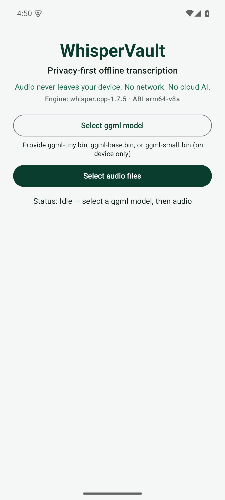
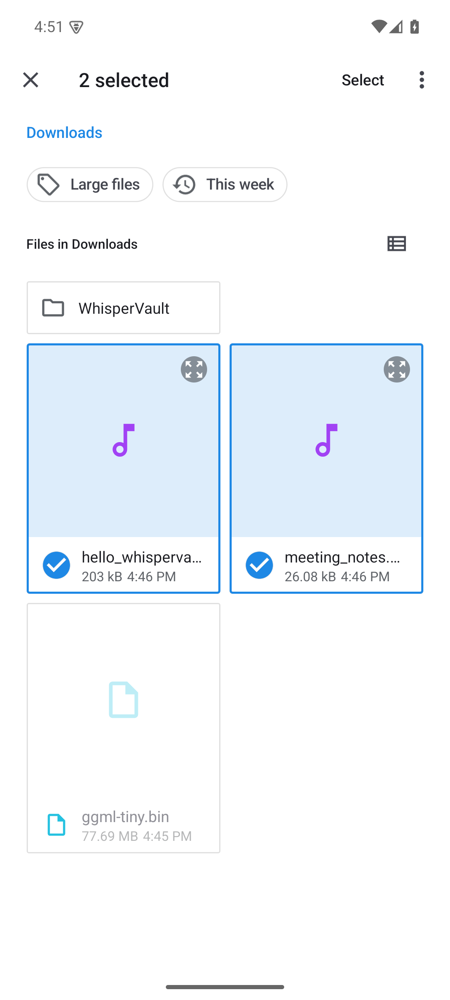
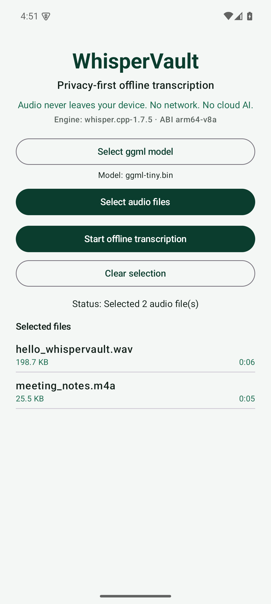
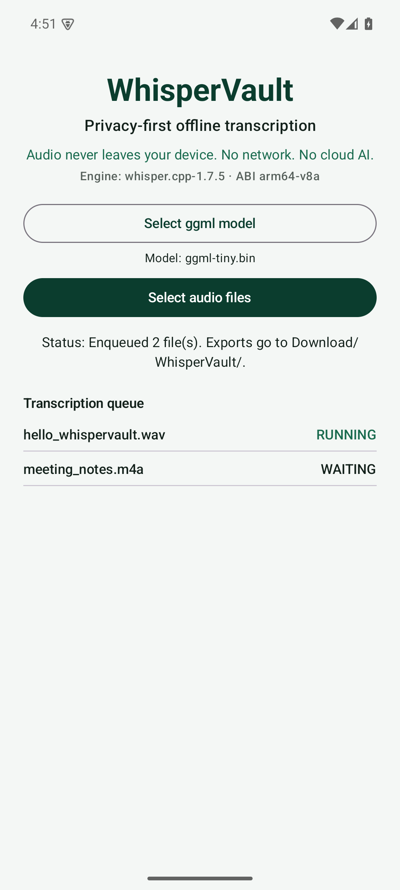
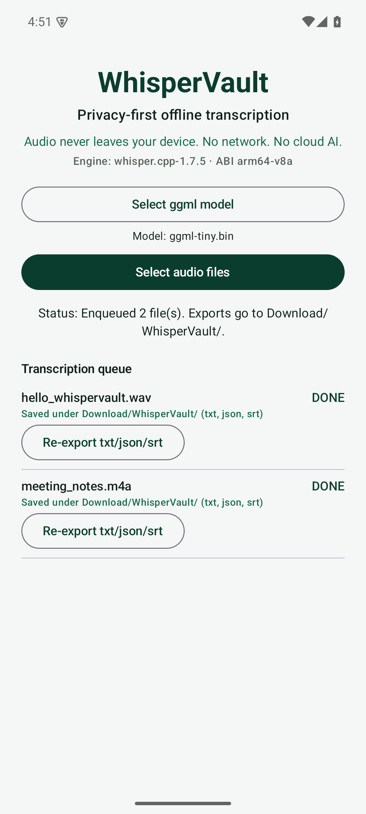
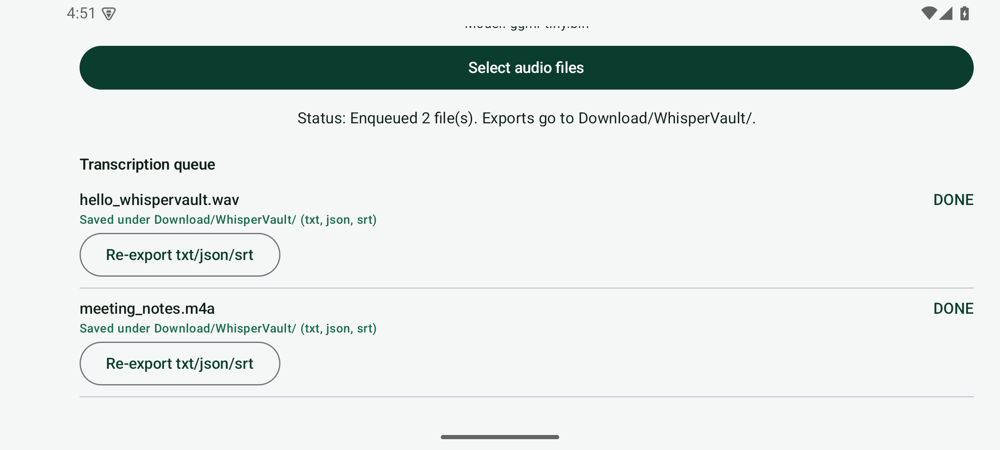

# WhisperVault

Privacy-first **offline** audio transcription for Android. Select audio on your phone, transcribe fully on-device with whisper.cpp, and save text locally. Audio never leaves the device.

**Version:** 1.0.0

## Privacy rules

- No uploads of audio or transcripts
- No OpenAI (or any cloud) API calls
- No in-app AI agent
- No `INTERNET` permission
- Models stay on device (user-provided ggml files)

## Install

1. Download the release APK from the GitHub Releases page (arm64-v8a devices).
2. Install (enable install from unknown sources if prompted).
3. On first use, grant notification permission if asked (for foreground transcription progress).

The v1.0.0 APK is **debug-signed** for a reproducible open-source drop. You may also build a release APK locally with the debug keystore, or create your own untracked keystore (never commit keystore passwords).

## Model setup

Download official ggml weights yourself (e.g. [ggerganov/whisper.cpp on Hugging Face](https://huggingface.co/ggerganov/whisper.cpp)) and pick them in the app:

| Size | Typical filename |
|------|------------------|
| tiny | `ggml-tiny.bin` |
| base | `ggml-base.bin` |
| small | `ggml-small.bin` |

The app never downloads models and never commits `*.bin` files. Missing models fail clearly.

## Supported audio formats

mp3, wav, m4a, flac, aac, ogg — decoded on-device to 16 kHz mono PCM.

## Export location

Successful transcriptions are written to **Download/WhisperVault/** via MediaStore:

- `.txt` — plain transcript
- `.json` — text + segment timings + model path
- `.srt` — SubRip cues from whisper.cpp segments

## How to use

1. **Select ggml model** (tiny/base/small `.bin` on device)
2. **Select audio files** (multi-select, up to 100 enqueued)
3. **Start offline transcription** — work continues with the screen locked
4. When a task is **DONE**, files appear under Download/WhisperVault/ (or tap re-export)

## Build from source

Prerequisites:

- JDK 17+
- Android SDK Platform 35, Build-Tools 35+
- Android NDK 26.1.10909125 and CMake 3.22.1

```properties
# local.properties (gitignored)
sdk.dir=/path/to/Android/sdk
```

```bash
./gradlew :app:assembleRelease
# APK: app/build/outputs/apk/release/app-release.apk
```

Debug:

```bash
./gradlew :app:assembleDebug
```

## Testing

```bash
./gradlew :app:testDebugUnitTest
```

Instrumentation (device/emulator required; arm64 recommended):

```bash
./gradlew :app:connectedDebugAndroidTest
```

No ggml model is required for the unit or UI-launch instrumentation tests.

## Offline ASR details

- ABI: **arm64-v8a** only
- Engine: pinned **whisper.cpp v1.7.5** under `third_party/whisper.cpp`
- JNI: `app/src/main/cpp/` → `libwhispervault.so`

## Module map

| Path | Role |
|------|------|
| `ui/` | Compose UI (Material3) |
| `viewmodel/` | MVVM state |
| `data/` | Room models + queue repository |
| `storage/` | SAF + MediaStore export |
| `transcription/` | Offline ASR facade + JNI |
| `worker/` | WorkManager foreground worker |
| `app/src/main/cpp/` | JNI + CMake |
| `third_party/whisper.cpp/` | Vendored whisper.cpp v1.7.5 |

## Verified for 1.0.0

These checks were run on an Android 15 (API 35) arm64-v8a emulator with `ggml-tiny.bin`:

- SAF multi-select of a `.wav` and an `.m4a` file
- Model load through JNI, then `whisper_full` transcription of both files (DONE)
- `.txt`, `.json`, and `.srt` written to `Download/WhisperVault/`, with SRT cues taken from whisper segment timestamps
- Queue state kept across rotation to landscape and back
- `connectedDebugAndroidTest` (home screen launch) passed

Not yet verified on physical hardware: long recordings (more than 30 minutes), 100-file batches, and continued work while the screen is locked. Those paths are implemented (foreground `dataSync` worker, windowed inference) but have not been measured on a real device.

## Screenshots

| Home | File selection | Selected files |
|------|----------------|----------------|
|  |  |  |

| Queue running | Done + exported | Landscape |
|---------------|-----------------|-----------|
|  |  |  |

## License

MIT — see [LICENSE](LICENSE). whisper.cpp is MIT (see `third_party/whisper.cpp/LICENSE`).
